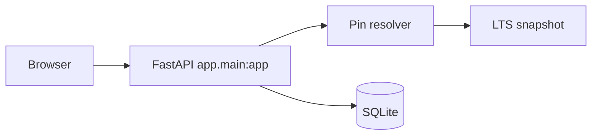

# Cobalt Studio — Alan Vo | AI & Machine Learning

> Work in progress. This checkpoint may be incomplete or fail tests. See PLAN.md and STATUS.md before use.


Machine-learning projects pin Node.js in more than one place, and those pins disagree. Cobalt Studio reads `.node-version`, `.nvmrc`, and `package.json` `engines.node`, then selects the highest installed release that satisfies the winning pin. It is a deterministic constraint matcher for people who maintain notebooks, evaluation dashboards, and other Node-based ML tooling. A missing install is stored as data with caller exit code 0, so the result can be recorded without looking like a crash.

This checkpoint is a local resolver and a small web UI. It does not install Node, edit `PATH`, or sign in users.

## What this checkpoint does

- Create a project and paste the three pin files plus the installed releases.
- Keep `.node-version` ahead of `.nvmrc`, and both ahead of `engines.node`. A higher file that does not parse does not fall through.
- Match exact releases, partial versions (`20`, `20.18`), comparators, `^` and `~`, `||`, full hyphen ranges, `node`, `stable`, `lts/*`, and `lts/<codename>`.
- Choose the highest installed match. `lts/*` means the latest line in the bundled snapshot, which is krypton (major 24) as of 2026-10-14. Node 26 was still Current then and is not selected by `lts/*`.
- Store the result in SQLite, search projects, page through them, and export the API record as JSON.

## Install and run

Python 3.12 and Node 24 are expected.

```bash
python3 -m venv .venv
.venv/bin/pip install -r backend/requirements.txt
PYTHONPATH=backend .venv/bin/python -m uvicorn app.main:app --host 127.0.0.1 --port 8000
```

In a second shell:

```bash
cd frontend
npm ci
npm run dev
```

Open `http://127.0.0.1:5173`. The UI calls `http://127.0.0.1:8000` unless `VITE_API_BASE` is set at build time. Leave the API on loopback.

The database file defaults to `backend/data/cobalt.sqlite`. Set `COBALT_DATABASE_PATH` to move it. Docker and local uvicorn both load `app.main:app` from `create_app`.

## Tests

```bash
PYTHONPATH=backend .venv/bin/python -m pytest backend/tests
PYTHONPATH=backend .venv/bin/python -m app.core.evaluate
cd frontend
npm test
npm run build
```

## AI/ML evaluation

The baseline is the deterministic resolver, not a trained model. The labeled set is `backend/app/data/pin_cases.json`. Those cases were written for this resolver's rules (ML toolchain pins such as a notebook UI, an eval worker, and a model-card site). The score checks that the implementation still agrees with those rules. It does not compare Cobalt Studio with another version manager.

```bash
PYTHONPATH=backend .venv/bin/python -m app.core.evaluate
```

Run on this checkout:

```text
cases 11
passed 11
source_agreement 11/11
status_agreement 11/11
match_agreement 11/11
exit_agreement 11/11
failures none
```

Known failure cases, all rejected on purpose: prerelease tags, partial hyphen ranges such as `18 - 20`, and the aliases `system`, `iojs`, `current`, and `unstable`. `lts/*` will not follow a newer Current line until the snapshot in `backend/app/core/lts.py` is updated.

## Architecture



The browser sends pin text and an installed catalog. The API validates the body, resolves one pin, and commits the project or resolution together with an audit row.

## API

| Method | Path | Purpose |
| --- | --- | --- |
| GET | `/api/health` | Liveness. Returns `{"status":"ok"}`. |
| GET | `/api/version` | Product version read from `VERSION`. |
| POST | `/api/projects` | Create `{name, purpose}`. |
| GET | `/api/projects?q=&limit=&offset=` | Search names and page the list. |
| GET | `/api/projects/{id}` | Read one project. |
| POST | `/api/projects/{id}/resolutions` | Resolve `{node_version, nvmrc, package_json, installed}`. |
| GET | `/api/projects/{id}/resolutions?status=&limit=&offset=` | Page resolutions. `status` is `satisfied`, `missing`, or `invalid`. |
| GET | `/api/resolutions/{id}` | Read one stored resolution, including the inputs that produced it. |

A usable pin that is not installed returns HTTP 201 with `status: "missing"` and `caller_exit_code: 0`. Unreadable pin text is stored with `status: "invalid"` and `caller_exit_code: 2`. An empty pin set or a partial catalog entry returns HTTP 422 and writes nothing.

## Security limitations

There is no authentication. Anyone who can reach the API can read and write every project. Bind it to `127.0.0.1` and do not put this checkpoint on a public interface. A later round can add OIDC; this one does not silently enable a demo login.

CORS allows only the local Vite origins `http://127.0.0.1:5173`, `http://localhost:5173`, `http://127.0.0.1:4173`, and `http://localhost:4173`.

No provider key is read. The resolver does not call a language model.

For a hosted deployment, terminate TLS at a reverse proxy and forward to the API. Do not send the SQLite file or the API port straight to the internet.

Backup: stop the API, then copy `COBALT_DATABASE_PATH` (or the `cobalt-data` volume file). Restore by replacing that file while the API is stopped.

## Docker

Build from the repository root so the Dockerfiles can see `VERSION` and the frontend lockfile.

```bash
docker compose up --build
```

The host ports are `127.0.0.1:8000` and `127.0.0.1:4173`. Inside the containers the processes listen on all interfaces so the published port works; the compose file does not publish them beyond loopback.

## Not in this checkpoint

Shell snippets, fish activation, non-interactive `PATH` files, binary architecture checks, manager self-update, a remote Node index, OIDC, and advisory model explanations are tracked in `PLAN.md`. They are not implemented.

## License

MIT. Copyright (c) 2026 Alan Vo <alanvo@gmail.com>.

Alan Vo
alanvo@gmail.com
